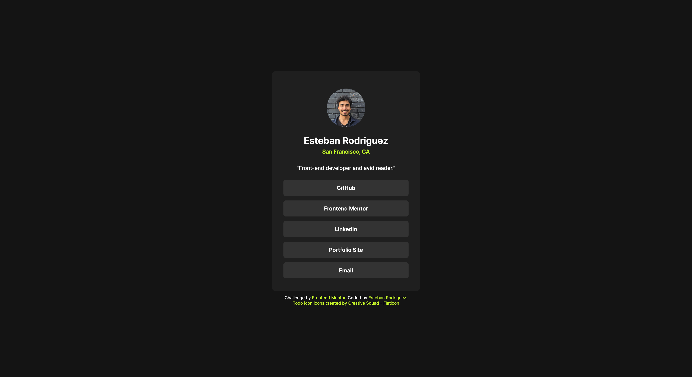

# Frontend Mentor - Social links profile solution

This is a solution to the [Social links profile challenge on Frontend Mentor](https://www.frontendmentor.io/challenges/social-links-profile-UG32l9m6dQ). Frontend Mentor challenges help you improve your coding skills by building realistic projects.

## Table of contents

- [Overview](#overview)
  - [The challenge](#the-challenge)
  - [Screenshot](#screenshot)
  - [Links](#links)
- [My process](#my-process)
  - [Built with](#built-with)
  - [What I learned](#what-i-learned)
  - [Continued development](#continued-development)
  - [Useful resources](#useful-resources)
  - [AI Collaboration](#ai-collaboration)
- [Author](#author)

## Overview

### The challenge

Challenge is to build out this social links profile and get it looking as close to the design as possible.

Users should be able to:

    -See hover and focus states for all interactive elements on the page

Download the starter code and go through the README.md file. This will provide further details about the project. The style-guide.md file is where you'll find colors, fonts, etc.

### Screenshot



### Links

- Github URL: [Github Repository](https://github.com/estebanrodriguez28/social-links-profile)
- Live Site URL: [Live Site](https://estebanrodriguez28.github.io/social-links-profile/)

## My process

- Sturctured semantic HTML first
- Wrote out base styles in css (fonts, resets)
- Added styles in css from top of the page down

### Built with

- Semantic HTML5 markup
- CSS custom properties
- Flexbox
- CSS Grid

### What I learned

When you set a flex container to column and set align-items to center, the flex items width does not stretch out to fill the container, instead their width fits to the content. This made the nav element sorrounding the links match the width of the links, but the design was for the links to take up the whole width of the card.

Solution was to make the nav stretch to fill the entire card using the align-self property so that the hyperlinks could be styled to fill the whole card.

```css
.social-links-card {
  display: flex;
  flex-direction: column;
  align-items: center;
}

.social-links-card nav {
  align-self: stretch;
}
```

Variable fonts allows you to declare custom font once in the css and set a font-weight range instead of importing several different font files (bold, semi-bold, etc) making variable fonts more flexible and concise.

```css
@font-face {
  font-family: Inter;
  src: url("assets/fonts/Inter-VariableFont_slnt\,wght.ttf");
  font-weight: 400 700;
}
```

Images that have a height or width that is not equal will not be a symetrical circle with the border radius preoprty. To fix this set width and height to be the same then use object-fit in css to preserve aspect ratio so image does not look stretched out

```css
#profile-img {
  width: 100px;
  height: 100px;
  object-fit: cover;
  border-radius: 50%;
  margin: 15px 0px;
}
```

I learned how to set up a block of nav links using semantic html (nav, ul, li). Also how to use Emmet, shortcut for writing html quickly to create multiple links using this structure you can do:

```html
nav>ul>(li>a)*5
```

to make html quicker to create

```html
<nav>
  <ul>
    <li>
      <a
        href="https://github.com/estebanrodriguez28"
        target="_blank"
        rel="noopener noreferrer"
        >GitHub</a
      >
    </li>
  </ul>
</nav>
```

For styling navigation links, I learned that we can make hyperlinks (a tags) display block since a tags are inline. To make the link take up full width of the card we set display to block.

Also I was going to style the list item instead of the a tag however the a tag is where the user can actually click so its better to style the a tag instead so a user can click anywhere within the link's width not just the text which would happen if you style the li tag.

Focus visible makes sure keyboard users can see active states as they go through hyperlinks to receive visual feedback.

```css
.social-links-card a {
  display: block;
  /* Other properties */
  &:hover,
  &:focus-visible {
    background-color: var(--green);
    color: var(--grey-900);
  }
}
```

I wanted the text for the email hyperlink to change to my actual email on hover so to do that used a pseduo element. I also wanted to put an image in the link to show email could be copied so that was inserted with a pseudo element as well.

However setting the width for the image as pseduo element did not work so had to use background-image and background-size properties. Why? Not sure stackoverflow pointed me those properties.

When you set a parent to position relative then you can set positon absolute to the children and the children are absolutely positioned within its parent!

```css
#email {
  position: relative;
  &:hover {
    & > span {
      display: none;
    }

    &::after {
      content: "erod9246@gmail.com";
    }

    &::before {
      position: absolute;
      content: "";
      background-image: url(assets/images/todo-icon.png);
      background-size: cover;
      width: 20px;
      height: 20px;
      top: 0;
      right: 0;
      margin: 5px;
    }
  }
}
```

Bit of javascript to copy my email to clipboard when its link is clicked

```js
const copyClipboard = () => {
  const email = document.getElementById("email");
  navigator.clipboard.writeText("erod9246@gmail.com");
  alert("Copied email: " + "erod9246@gmail.com");
};
```

Lastly, within the footer, I wanted the last link to break onto the next line since the links looked too squished together being all in the same line. I tried setting a width small enough on the parent container to break the last link onto next line but that caused layout issues with hover states.

A fix I got from Claude was to think about how in writing, separate thoughts go in separate paragraphs, after that I got the idea to use p tag to wrap first two links so they become wrapped in a block element and take up a whole line. So then the next link has to break onto the next line, no problems with hover states.

```html
<p>
        Challenge by
        <a href="https://www.frontendmentor.io?ref=challenge" target="_blank"
                rel="noopener noreferrer">Frontend Mentor</a
        >. Coded by
        <a href="https://github.com/estebanrodriguez28" target="_blank"
                rel="noopener noreferrer"" >Esteban Rodriguez</a>.
      </p>
```

### Continued development

I realized that there are some concepts in flex that I still dont fully understand such as how aling-items fit flex items width to their content. Going to continue practicing with project to gain better understanding of flex.

### Useful resources

I should save my resources as I go along cause I close them then forget which one I used specifically. However here's what I remember for this project:

- Semantic HTML Article - There was an article that went through examples of semantic html that is where I noticed that I was missing more semantic html for my hyper links (nav, ul, li) before I just had all the nav links by themselves as a tags
- [Copy to clipboard](https://www.w3schools.com/howto/howto_js_copy_clipboard.asp) - This article showed be how to use javascript to copy to clipboard

### AI Collaboration

- I used Claude Desktop, connecting my project to a chat
- I used Claude for debugging and to guide me closer toward the design. When I did not know why my links weren't taking up the full width of the card I asked Claude what I thought was the problem the nav tag being the flex item but not taking up the full width. That question guided me toward realizing how flexbox works with align-items.
  \_ Process generally is when stuck, search first, then if still stuck tell Claude what the problem is and what I am thinking to solve it. Then Claude based on the instructions included by Front-end mentor, guides me toward the answer by asking me questions rather than giving me the answer
- At first claude gave me the answer for why my image was not a symmetrical circle pointing me toward the css property and giving me copy and paste solution. For some reason clauded did not read the AI instructions in this project before giving me the first answer. I learned how to solve it and eventually why but I did not think through the problem enough to solve it by myself since claude gave me full answer
- I think what went well is how Claude guides me toward answers/understanding what didn't go well was the first answer I got giving me a complete solution

## Author

- Frontend Mentor - [@estebanrodriguez28](https://www.frontendmentor.io/profile/estebanrodriguez28)
